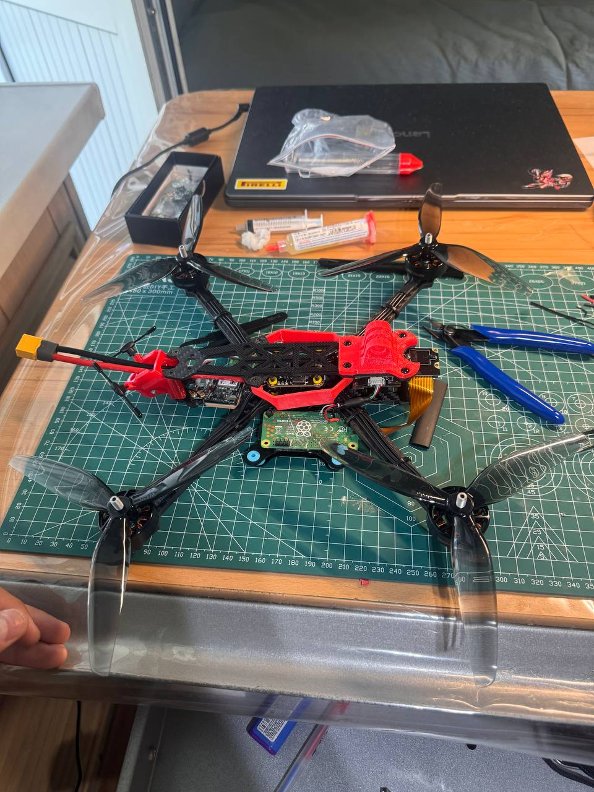
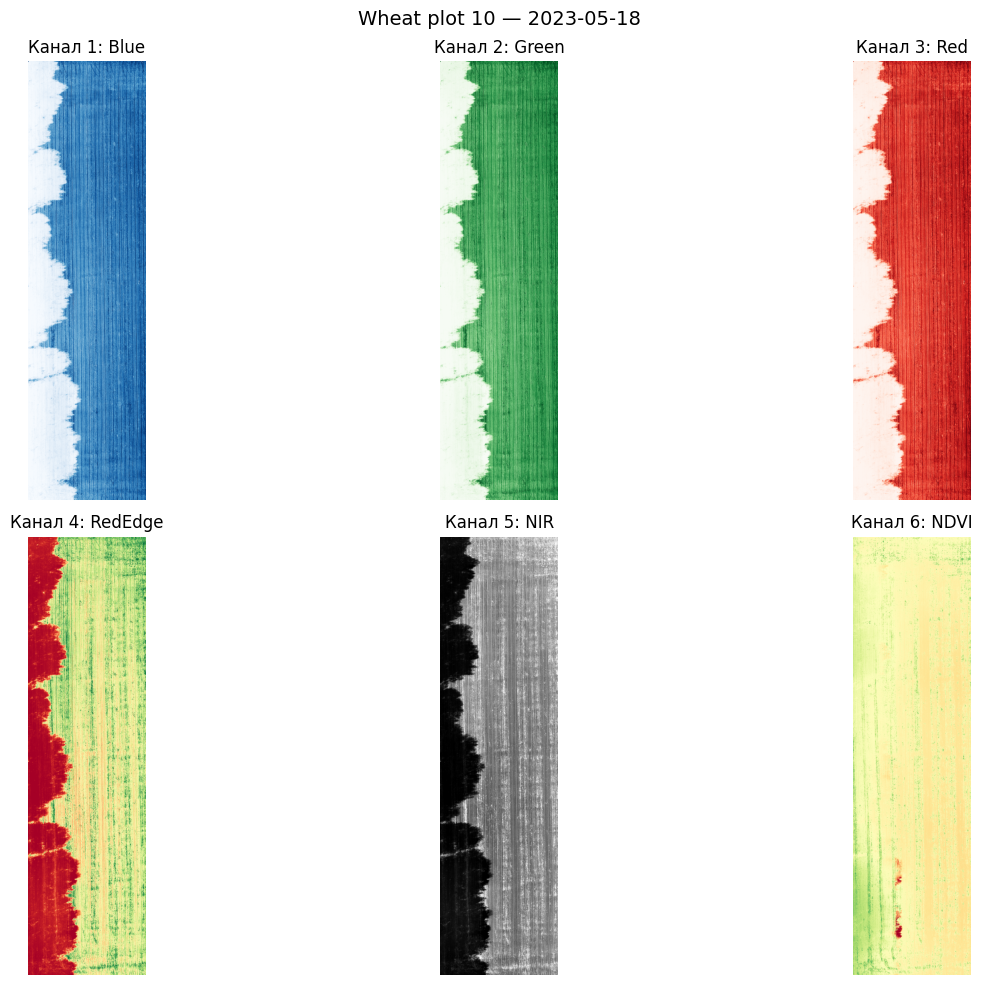
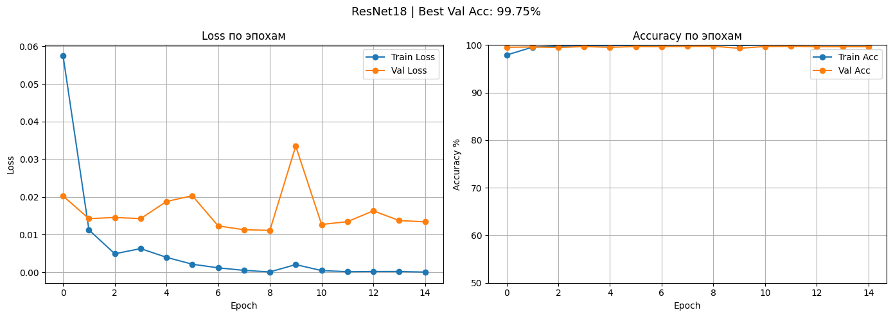
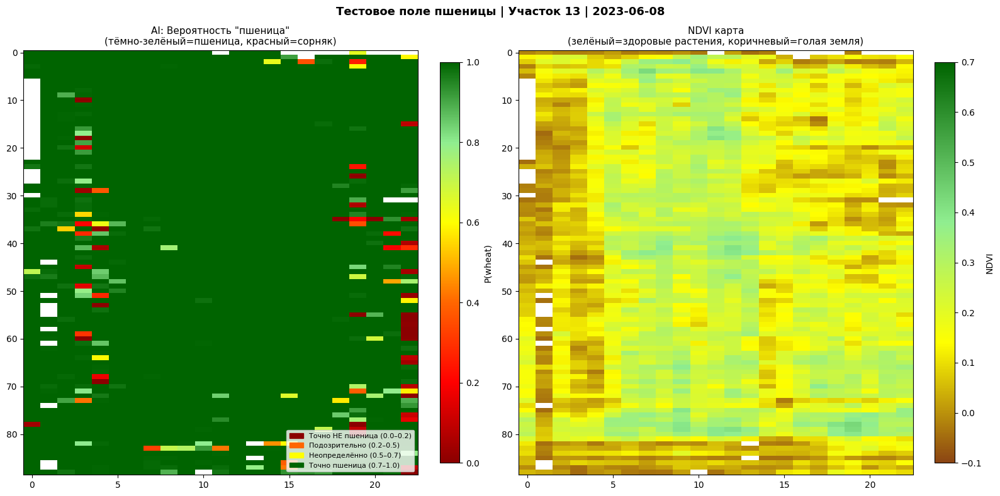
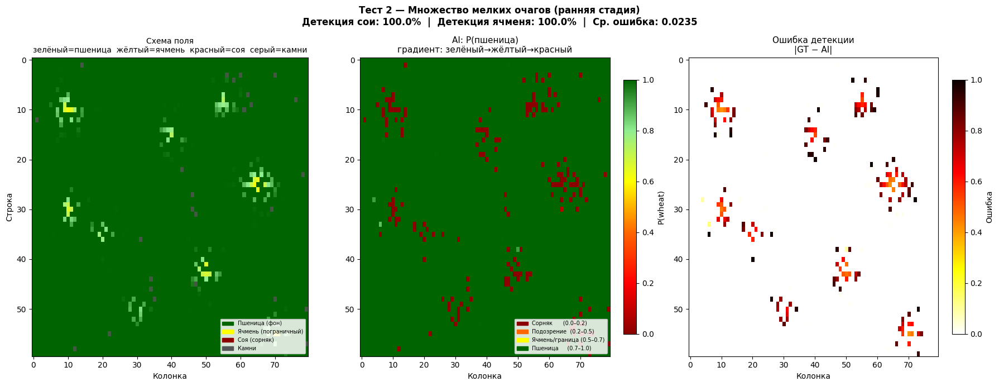

# AgroFly
### Turning multispectral observations into a readable field map.

A precision-agriculture investigation spanning a scout-drone build, crop classification experiments and a product concept for field analysis. The work connects hardware constraints to an ML pipeline instead of treating the drone as a decorative part of an AI demo.

*The physical scout-drone build documented during the project.*

**Status: development on hold.** The scout-drone build and software experiments are documented below; no real-world agricultural pilot was completed. A future restart remains possible, subject to field access, representative data and funding.

## The question behind the prototype

Can aerial observations become a map that helps someone inspect what is growing in different parts of a field? AgroFly explored that question through a bounded first experiment: distinguishing **wheat and soybeans** from multispectral image tiles. Weed detection, disease diagnosis and autonomous spraying were not established by this classifier.

The project was split into a sensing platform, a training pipeline and a field-level presentation. This separation matters: a promising result on a supplied dataset does not automatically transfer to a different camera mounted on a drone.

## Start with all six bands

The experiment uses six-channel imagery. A conventional image classifier expects three colour channels, so the ResNet-18 input was adapted for the available multispectral bands. Tiles preserve the spectral channels together; the model learns from the combined observation rather than classifying a screenshot of a rendered map.

*The six-band dataset view: these are the model inputs, not six independent photographs.*

The training workflow prepares labelled tiles, fits the classifier and records learning curves. The resulting predictor is then applied across a larger field arrangement so that local predictions can be inspected spatially. A field map makes obvious errors easier to notice than a single aggregate accuracy figure.

*Recorded training and validation curves from the crop-classification experiment.*

## Accuracy needs a spatial explanation

The documented random-tile experiment reported **99.75% accuracy**. Nearby tiles can share soil, illumination, crop stage and capture conditions, so that number should not be read as independent-farm performance. A held-out plot is a stronger check than random tiles from the same capture, but it still shares a field and season with the source data.

*Held-out wheat plot 13. This checks a withheld plot within the available field/season, not a new farm or sensor.*

The synthetic field test serves a different purpose: it exercises the end-to-end mapping and visualization workflow using a constructed field arrangement. It is useful for checking the pipeline and presentation, but is not evidence of deployment accuracy.

*Explicitly synthetic field test used to inspect map inference and presentation.*

## From capture to a map

~~~mermaid
flowchart LR
 A[Multispectral dataset] --> B[Aligned six-band tiles]
 B --> C[Adapted ResNet-18]
 C --> D[Tile predictions]
 D --> E[Spatial field visualization]
 F[Scout-drone hardware] -. sensor and domain gap .-> A
~~~

| Layer | What was built | What it demonstrates |
|---|---|---|
| Hardware | Scout-drone assembly and sensing investigation | A physical platform and its integration constraints |
| ML | Six-channel crop classifier | A bounded wheat/soybean discrimination experiment |
| Analysis | Training curves and held-out-plot inspection | Visibility into learning behaviour and spatial generalization |
| Presentation | Field maps and a product website | How a prediction could become a useful field view |

**Technology:** Python, multispectral image processing, PyTorch / ResNet-18, field-map inference and drone hardware. The product website is separate from the experimental model.

## Project status and engineering retrospective

**Development is on hold; a future restart remains possible.** AgroFly produced a scout-drone build, a crop-classification pipeline, field-map experiments and a product website. These are prototype outcomes, not a validated agricultural service. No real-world field pilot was completed, and the proposed spraying drone was neither built nor purchased.

### Why the field pilot did not happen

Required drone components arrived after the intended growing-season window had passed. The team therefore missed the opportunity to collect representative imagery and evaluate the system in the field that season. Nurali subsequently moved to Malaysia for his studies and took the scout drone with him, leaving the team without local access to that platform for a Kazakhstan-based pilot.

### 1. Coverage was constrained by flight endurance and imaging requirements

The scout configuration had an approximately **30-minute flight-endurance constraint**. With the selected camera, obtaining the desired image detail required relatively low-altitude flight, reducing coverage per pass. Over large agricultural fields, that combination implied lengthy survey operations, repeated battery changes and a substantial battery inventory. The team did not establish a practical, costed field-survey workflow through a pilot.

A tethered-power approach was considered but rejected because of the cost of cable over the required distances, transport and handling requirements, and concerns about mechanical strength. It did not resolve the coverage problem within the project's available resources.

### 2. Strong dataset results did not establish field generalization

Model development depended heavily on one multispectral dataset. Although that dataset comes from East Kazakhstan, its availability did not provide sufficient diversity of farms, seasons, crop conditions and sensors for the intended deployment. The experiments exposed a substantial risk of overfitting and dataset-specific bias; high within-dataset accuracy was not evidence of reliable performance on new fields.

Building a representative dataset would require repeated field collection, reliable labels and agronomic expertise. Illumination, weather, crop growth stage and sensor differences can change the model's inputs in ways that matter for evaluation and retraining. The gap between the dataset's calibrated multispectral camera and the scout drone's RGB/NoIR cameras also remained unresolved.

### 3. Funding depended on evidence the prototype could not yet provide

The team did not secure funding without a completed field pilot. As a result, the proposed second drone for targeted spraying remained a concept: assembling or purchasing a suitable platform required capital beyond the project's available budget. The complete scout-to-treatment workflow was never demonstrated.

### What would need to change before a restart

The central lesson is that flight operations, sensor selection, model validation and financing must be planned together. Improving the classifier alone would not resolve the field-coverage or deployment constraints.

A credible restart would begin with a **small, clearly scoped scouting pilot**, before committing to a spraying platform:

- Secure local access to a drone, a partner field and agronomic support before the relevant growing-season window.
- Measure achievable image detail and area coverage at different altitudes, including battery changes and operating costs.
- Align the sensor with the learning task; collect and label representative data, then evaluate on independently held-out fields and capture dates.
- Use the pilot's operational results and model limitations to assess feasibility and support a funding decision for any subsequent treatment stage.

These are conditions for reconsidering development, not an announced relaunch or a committed delivery schedule. The completed work is preserved as a basis for that decision.

## Competition certificates

**Finalist at the Jas Urpaq Founders Project Competition**, documented by a certificate issued to AgroFly on **29 August 2026**, with Turan University and Galanz Bottlers. The two personal certificates below document participation and appreciation associated with AgroFly.

[Original documents and certificate gallery](docs/awards/README.md).

View the certificates

**Jas Urpaq Founders Project Competition — finalist**

**LaunchZone International StartUp Battle 2026 — participation**

**Step By Step — appreciation for active participation; no placement stated**

---

### Built by

[Shakhnazar Akhmer](https://github.com/Eye172) and **Bauyrzhan Nurali**.

[More projects](https://github.com/Eye172) · [Contact](mailto:shakh090909@gmail.com)

This repository presents the product and its engineering. The implementation is maintained separately. Screenshots and documented experiments are identified in their captions; a live deployment is not required to explore the case study.
