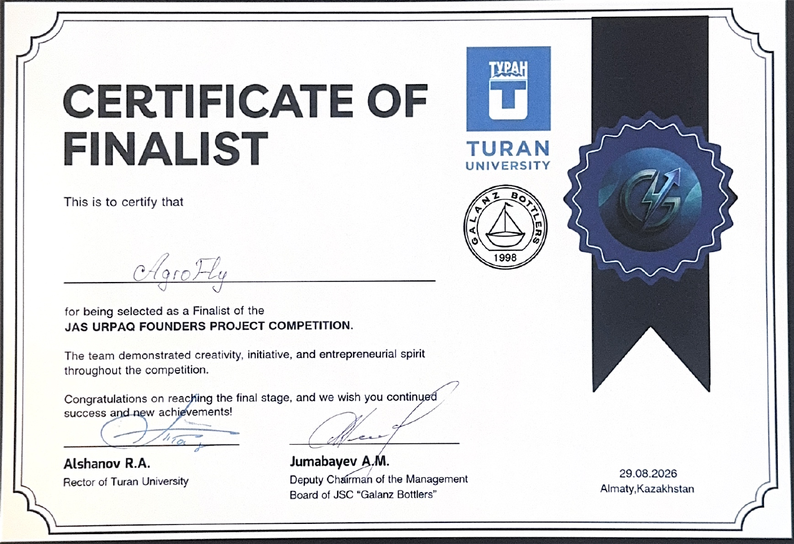
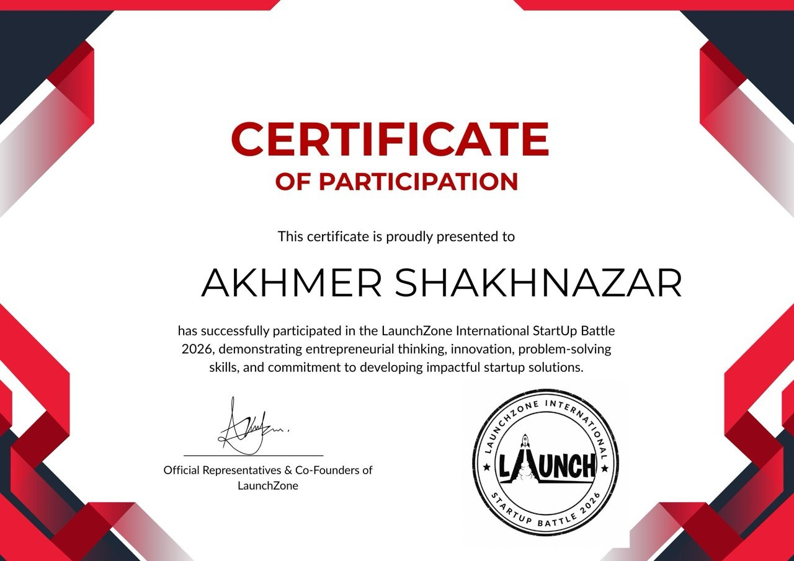
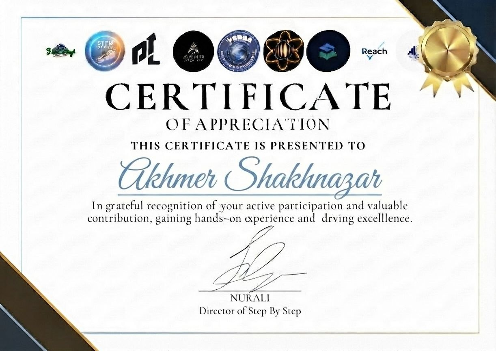

# AgroFly: certificates

**Finalist at the Jas Urpaq Founders Project Competition**, documented by a certificate issued to AgroFly on **29 August 2026**, with Turan University and Galanz Bottlers. The two personal certificates below document participation and appreciation associated with AgroFly.

## Jas Urpaq Founders Project Competition — finalist

[Open the original document](jas-urpaq-finalist.pdf)

## LaunchZone International StartUp Battle 2026 — participation

[Open the original document](launchzone-participation.jpg)

## Step By Step — appreciation for active participation; no placement stated

[Open the original document](step-by-step-appreciation.jpg)

## Document provenance

Supplied by Shakhnazar Akhmer on 12 October 2026. Original documents are preserved byte for byte; PNG previews of PDFs are page renders. Project associations follow the submitted project records and Shakhnazar’s identification of the events. The two additional AgroFly certificates name Shakhnazar, while the finalist certificate names AgroFly.

[File checksums](manifest.json) · [Back to the project](../../README.md)
